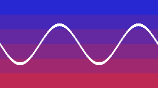
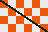
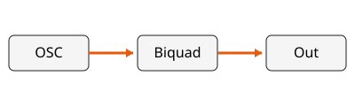

## 今日話すこと

- フロントマターとタイトルページ
- コンテンツページの Markdown 要素
- 高橋メソッドページ
- ページ単位のデザイン変更(`class`)
- コードのハイライト・画像・列分割・数式・全面画像ページ

---

## 箇条書きと番号付きリスト

- 1階層目の項目
  - 2階層目の項目
  - もう1つの2階層目
- **太字**、*斜体*、~~取り消し線~~、`インラインコード`

1. 番号付きリスト
2. 2つ目
   1. 入れ子の番号付き

---

## 表と引用

| 項目 | 値 | 備考 |
| --- | ---: | :---: |
| サンプリング周波数 | 48000 | Hz |
| バッファサイズ | 128 | サンプル |

> 引用ブロックです。
> 1つの改行はそのまま改行になります。

---

## 段落とリンク

段落の中の改行は
そのまま改行として表示されます。

リンクは新しいタブで開きます: [centrevillage/onsalang](https://github.com/centrevillage/onsalang)

生HTMLも使えます: <span style="color: #e8590c">オレンジの文字</span>

***

`***` は水平線になります(`---` はスライド区切りです)。

---

## コード片(タイトルと行ハイライト)

```js title="separator.js" {2-4}
// フェンスの中の --- はスライド区切りにならない
const separator = `
---
`;
```

<!-- note: 発表者ノートは出力に含まれない -->

---

## C++(Zenn/Qiita 式のタイトル・行番号)

```cpp:biquad.cpp showLineNumbers {3}
float Biquad::process(float x) {
  // Direct Form I
  float y = b0*x + b1*x1 + b2*x2 - a1*y1 - a2*y2;
  x2 = x1; x1 = x; y2 = y1; y1 = y;
  return y;
}
```

---

## Rust / Python / Go

```rs title="gain.rs"
fn apply_gain(buf: &mut [f32], gain: f32) {
    for s in buf.iter_mut() { *s *= gain; }
}
```

```py
def db_to_gain(db: float) -> float:
    return 10 ** (db / 20)  # dB -> 倍率
```

```go
func Mix(a, b float32) float32 { return (a + b) * 0.5 }
```

---

## TypeScript / C# / Java / Scala / Ruby / C

```ts
const ctx: AudioContext = new AudioContext({ sampleRate: 48000 });
```

```cs
public float Process(float x) => x * Gain;
```

```java
final double freq = 440.0 * Math.pow(2, (note - 69) / 12.0);
```

```scala
val samples = (0 until 64).map(i => math.sin(2 * math.Pi * i / 64))
```

```ruby
notes = %w[C D E F G A B].map { |n| "#{n}4" }
```

```c
static inline float clampf(float v) { return v < -1.f ? -1.f : (v > 1.f ? 1.f : v); }
```

---

## SuperCollider / FAUST

```supercollider title="sine.scd"
// SinOsc を鳴らす
(
SynthDef(\sine, { |out=0, freq=440, amp=0.1|
    Out.ar(out, SinOsc.ar(freq, 0, amp) ! 2);
}).add;
)
~synth = Synth(\sine, [freq: 880]);
```

```dsp title="lowpass.dsp"
import("stdfaust.lib");
// 1次ローパス
process = fi.lowpass(1, 1000) <: _, _;
```

---

## Onsa(自作言語)

```onsa title="dsp.onsa" {3}
/// 素朴なのこぎり波（エイリアシングあり。例示用）
pub flow saw(f0: F32 at block) -> F32 at sample {
  let phase = wrap01(prev~(^phase) + (f0 / sample_rate()))
  (2.0 * phase) - 1.0
}
```

---

## ハイライトしない言語

```zig
// 対応外の言語は警告を出してハイライトせずに表示する
const std = @import("std");
```

```
言語指定のないコード片はハイライトしない
<タグ> & "引用符" もエスケープされる
```

---

<!-- page: title -->
# 第2部: 高橋メソッド
大きな文字で伝える

---

<!-- page: takahashi -->
音を
**書く**

---

# 省略記法の
# 高橋メソッド

---

<!-- page: content, class: inverse -->
## 反転したページ

- `class: inverse` で背景と文字の色を反転する
- デザインの `design.json` の `classes` に定義された値だけを使う

---

# H1 と本文が混在する場合

H1 はページタイトル(H2 と同じ扱い)になります。

### 小見出し(H3)

- 本文

---

## 画像(PNG・幅指定・キャプション)

{width=60%}

---

## 画像(SVG・BMP)

"){width=800px}

{width=20%}

---

## 画像が見つからない場合


行内の画像 {width=40px} は警告を出してそのまま出力する

---

## 列分割(1:2)

::: col
### Before
- 消費電力 120mA
- ノイズ多め
:::

::: col 2
### After

:::

列分割の後に通常の本文を置ける

---

## 列分割(3列・コードと表)

::: col
```js
const a = 1;
```
:::

::: col
| 項目 | 値 |
| --- | ---: |
| fs | 48000 |
:::

::: col
- 3列まで
- 上揃え
:::

---

## 数式

行内の数式 $f_c = \frac{1}{2\pi RC}$ と、ドル記号そのもの \$100。

$$
H(z) = \frac{b_0 + b_1 z^{-1} + b_2 z^{-2}}{1 + a_1 z^{-1} + a_2 z^{-2}}
$$

$$y[n] = \sum_{k=0}^{N-1} h[k]\,x[n-k]$$

コードの中の `$x$` は数式にならない。

---

<!-- page: image, fit: cover -->

2026.08 下北沢(fit: cover)

---

<!-- page: image, fit: contain -->


全面画像ページ(fit: contain)
